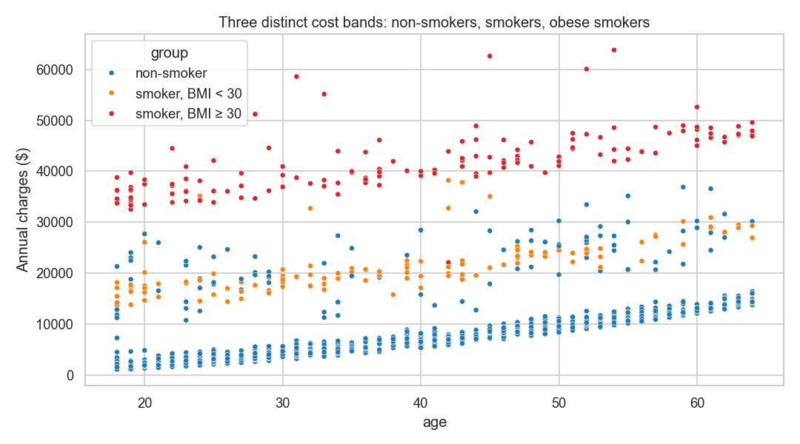

# 🏥 What drives medical insurance costs? A statistical analysis

A research-style statistical study of **1,337 insured people**: hypothesis tests with **effect sizes and confidence intervals**, a confounding check, group comparisons with post-hoc tests, an **interaction** discovered in the data, and a regression model whose **assumptions are actually checked**.


📓 **Full report:** [`notebooks/insurance_cost_analysis.ipynb`](notebooks/insurance_cost_analysis.ipynb)

**Data:** [Medical Cost Personal Dataset](https://www.kaggle.com/datasets/mirichoi0218/insurance) — age, sex, BMI, children, smoker, region and annual charges (1,338 rows, one exact duplicate removed). Charges are strongly right-skewed, so every comparison pairs a parametric test with a **rank-based** one.

## Findings

### RQ1 — Do smokers pay more? Yes, about 4×
| | Smokers (n = 274) | Non-smokers (n = 1,063) |
|---|---|---|
| Mean | $32,050 | $8,441 |
| Median | $34,456 | $7,346 |

Welch t-test and Mann-Whitney both p < 10⁻¹⁰⁰; **Cohen's d = 3.16** (0.8 is conventionally "large"); rank-biserial correlation 0.95; median difference **$27,100**, bootstrap 95% CI [$22,200, $28,900].

### RQ2 — Do men pay more? Only because more men smoke
Men's *mean* charges are higher ($13,975 vs $12,570, Welch p = 0.03), but the rank-based test finds no difference (p = 0.69). Men smoke more (23.6% vs 17.4%, χ² p = 0.005). In the regression, holding smoking and the other factors constant, the sex effect disappears (−$479, p = 0.06). **A textbook confounder.**

### RQ3 — Does region matter? Barely
No raw difference (Kruskal-Wallis p = 0.20; η² = 0.3%; no significant Tukey pair). With everything else held constant, the southwest is about $1,200 cheaper — small next to smoking.

### RQ4 — The key finding: smoking and obesity interact



Costs rise with age in **three parallel bands**:

| Mean annual charges | BMI < 30 | BMI ≥ 30 (obese) |
|---|---|---|
| Non-smoker | $7,977 | $8,856 |
| Smoker | $21,363 | **$41,558** |

For non-smokers, obesity adds almost nothing (+$204, not significant); for smokers it adds about **$19,900 a year**. Models that treat smoking and BMI as separate, additive factors mis-state both.

### RQ5 — Model comparison and assumption checks

| Model | Adj. R² (own scale) | 5-fold CV RMSE |
|---|---|---|
| log(charges), main effects | 0.766 | $9,580 |
| charges, main effects | 0.749 | $6,105 |
| **charges, smoker × obese interaction** | **0.862** | **$4,498** |

The log model looks reasonable on its own scale but predicts dollars worst — models must be compared on the **same scale**. The interaction model wins clearly.

**Final model** (HC3 robust SEs): smoker +$13,360; smoker × obese **+$19,855**; age **+$265 per year**; each child **+$524**.

**Assumptions checked:**
- **Heteroskedasticity:** none detected (Breusch-Pagan p = 0.89); robust SEs used anyway.
- **Multicollinearity:** VIF ≤ 2.1 for the main predictors.
- **Residuals:** a cluster of people cost far more than predicted — including **non-smokers in the middle band** of the chart (≈ $20–35k) — pointing to health information the dataset does not record.
- **Influence:** 90 points exceed Cook's 4/n rule of thumb; 89 of them are that high-cost group, the largest Cook's distance is 0.02 (far below 1), and refitting without them barely changes the key coefficient ($19,855 → $20,066).

## Conclusion

Smoking — and above all **smoking combined with obesity** — drives medical costs; age adds a steady amount; sex and region matter little once smoking is accounted for. For an insurer or an employer wellness programme, **smoking cessation for smokers with obesity** is where most of the cost is.

## Run it

```bash
pip install -r requirements.txt
kaggle datasets download -d mirichoi0218/insurance -p data --unzip
python build_notebook.py     # rebuilds and executes the report, writes reports/
python -m pytest -q          # effect-size helpers checked against known values
```

## Project structure

```text
├── stats_utils.py                 # Cohen's d, rank-biserial, Cramér's V, eta², % effects
├── build_notebook.py
├── notebooks/insurance_cost_analysis.ipynb
├── reports/                       # charts + results.json
└── tests/
```

## Tech stack

Python · pandas · NumPy · SciPy · statsmodels · scikit-learn · Matplotlib · Seaborn · Jupyter · pytest
